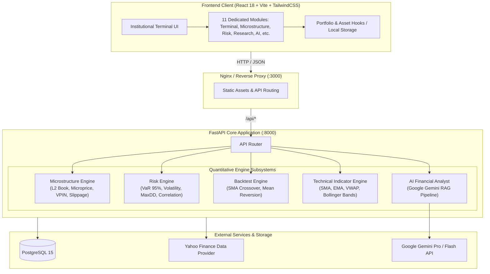

# QuantScope ⚡ Institutional Market Intelligence & Quantitative Terminal

[](https://www.python.org/)
[](https://fastapi.tiangolo.com/)
[](https://reactjs.org/)
[](https://www.typescriptlang.org/)
[](https://tailwindcss.com/)
[](https://www.docker.com/)
[](https://ai.google.dev/)
[](https://docs.pytest.org/)
[](LICENSE)

**QuantScope** is a high-performance, full-stack quantitative finance platform engineered for institutional market intelligence, algorithmic strategy research, risk modeling, and market microstructure analysis. Powered by a high-throughput **FastAPI** backend and an institutional-grade **React + TypeScript** dark-themed terminal UI, QuantScope bridges the gap between quantitative research and real-time execution analytics.

---

## 📑 Table of Contents

- [Key Capabilities](#-key-capabilities)
- [System Architecture](#-system-architecture)
- [Terminal Modules & Features](#-terminal-modules--features)
- [API Architecture & Endpoints](#-api-architecture--endpoints)
- [Tech Stack](#-tech-stack)
- [Quickstart Guide](#-quickstart-guide)
  - [Prerequisites](#prerequisites)
  - [Local Development Setup](#local-development-setup)
- [Production Deployment (Docker)](#-production-deployment-docker)
- [Environment Configuration](#-environment-configuration)
- [Testing & Quality Assurance](#-testing--quality-assurance)
- [License](#-license)

---

## 🚀 Key Capabilities

- **Market Microstructure Analytics:** Real-time simulated Level-2 order book depth, Microprice estimators, Order Book Imbalance (OBI), real-time Time & Sales tape, Volume-Synchronized Probability of Informed Trading (VPIN) toxicity metrics, and non-linear slippage/market impact estimators.
- **Institutional Risk Engine:** Historical Value at Risk (VaR 95%), Annualized Volatility, Maximum Drawdown (MDD), Sharpe Ratio, and multi-asset inter-correlation matrices.
- **Algorithmic Strategy Backtesting:** Simulation engine supporting SMA Crossover and Bollinger Band Mean Reversion strategies with dynamic parameter tuning and comparative performance benchmarking against Buy & Hold equity curves.
- **AI Financial Analyst (Gemini RAG):** Context-aware Retrieval-Augmented Generation (RAG) agent capable of conversational multi-turn financial Q&A, SEC 10-K risk/opportunity extraction, and real-time news sentiment scoring.
- **Cross-Asset Coverage:** Equities, major indices, FX rates, commodities, and digital assets.
- **Production-Grade Infrastructure:** Fully containerized with Docker & Docker Compose, PostgreSQL 15 persistence, Gunicorn/Uvicorn ASGI concurrency, and automated Pytest test coverage.

---

## 🏛 System Architecture



---

## 🖥 Terminal Modules & Features

| Module | Description | Core Metrics & Visuals |
| :--- | :--- | :--- |
| **Dashboard** | Executive overview of total portfolio value, 24h P&L, market pulse, and pinned watchlists. | Portfolio Value, Daily Return, Market Indices ticker tape, Asset Allocation breakdown. |
| **Market Terminal** | Deep-dive candlestick and line charting terminal with multi-timeframe resolution. | Overlays: SMA (20/50), EMA (20), Volume-Weighted Average Price (VWAP), Bollinger Bands. |
| **Markets Overview** | Macro heatmap and tabular scanner across global asset classes. | Performance across Equities, Indices, Crypto, FX, and Commodities. |
| **Microstructure** | High-frequency execution analytics and order book dynamics. | Level-2 Order Book ladder, Microprice, Imbalance (-1 to +1), Time & Sales tape, VPIN toxicity proxy, Slippage calculator. |
| **Portfolio Manager** | Multi-asset portfolio composition, asset weighting, and cash management. | Holdings table, current valuation, unrealized P&L, dynamic rebalancing simulation. |
| **Risk Analytics** | Comprehensive statistical risk modeling. | Historical VaR (95%), Annualized Volatility, Max Drawdown, full Cross-Asset Correlation Heatmap. |
| **Research & Backtesting**| Quantitative backtesting sandbox for algorithmic trading strategies. | SMA Crossover, Bollinger Band Mean Reversion, Sharpe Ratio, comparative equity curves vs. B&H. |
| **Fundamentals** | Deep corporate balance sheet and valuation screening. | Revenue, EBITDA, Net Income, P/E, EV/EBITDA, Debt-to-Equity, Profit Margins. |
| **News & Sentiment** | Real-time syndicated financial news feed with automated sentiment tagging. | AI Sentiment badges (Bullish / Neutral / Bearish), sentiment score [-1.0, 1.0], driver summaries. |
| **AI Financial Analyst** | Interactive conversational quantitative analyst powered by Google Gemini. | Contextual financial Q&A, SEC 10-K automated risk & opportunity synthesis. |
| **Data & Pipeline** | Data source connectivity and pipeline health monitoring. | Data provider latencies, database sync status, CSV/JSON data export utilities. |

---

## 🔌 API Architecture & Endpoints

All backend endpoints are prefixed with `/api` and documented automatically via OpenAPI/Swagger UI at `http://localhost:8000/docs`:

### Health & System
- `GET /api/health` — System health check, database status, and uptime.

### Market Data
- `GET /api/market/quote/{ticker}` — Real-time price quote, change, volume, and day range.
- `GET /api/market/historical/{ticker}?period=1y&interval=1d` — OHLCV historical time series.
- `GET /api/market/technical/{ticker}` — Historical data enriched with SMA, EMA, VWAP, and Bollinger Bands.

### Microstructure
- `GET /api/microstructure/orderbook/{ticker}` — Simulated Level-2 order book, top-of-book depth, and microprice.
- `GET /api/microstructure/tape/{ticker}` — Simulated real-time Time & Sales tape trades.
- `POST /api/microstructure/slippage` — Order book walking simulator estimating basis points of slippage for a given order size in USD.
- `GET /api/microstructure/metrics/{ticker}` — VPIN toxicity proxy, spread volatility, and cancel-to-fill ratios.

### Risk & Portfolio
- `POST /api/portfolio/analyze` — Evaluates portfolio returns, Historical VaR (95%), volatility, and cross-asset correlation matrix for specified weights.

### Quantitative Research
- `POST /api/research/backtest` — Executes historical backtests (SMA Crossover or Bollinger Band Mean Reversion) and returns equity curves alongside Sharpe ratios and drawdowns.

### AI Analyst
- `POST /api/ai/chat` — Context-aware chat query with financial context injection.
- `POST /api/ai/sentiment` — Multi-article sentiment scoring and summary generation.
- `GET /api/ai/sec-filing/{ticker}?doc_type=10-K` — Automated SEC filing risk and growth opportunity extraction.

---

## 🛠 Tech Stack

### Backend
- **Framework:** FastAPI (Python 3.10+)
- **Server:** Uvicorn (ASGI) / Gunicorn (Production)
- **Quantitative Libraries:** NumPy, Pandas, SciPy
- **AI Engine:** Google Gemini Generative AI SDK (`gemini-3.5-flash` / RAG pipeline)
- **Data Providers:** yfinance provider abstraction
- **Testing:** Pytest, HTTPX

### Frontend
- **Framework:** React 18 with TypeScript
- **Bundler:** Vite
- **Styling:** TailwindCSS, Lucide Icons, Class Variance Authority
- **Routing:** React Router v6
- **Charts & Visuals:** Custom SVG depth charts, interactive equity curves, correlation matrix heatmaps

### Infrastructure
- **Containerization:** Docker & Docker Compose
- **Web Server:** Nginx (Alpine-based frontend container)
- **Database:** PostgreSQL 15

---

## ⚡ Quickstart Guide

### Prerequisites
- [Python 3.10+](https://www.python.org/downloads/)
- [Node.js 18+](https://nodejs.org/) and npm
- [Git](https://git-scm.com/)
- *(Optional)* [Docker Desktop](https://www.docker.com/products/docker-desktop/)

---

### Local Development Setup

#### 1. Clone the Repository
```bash
git clone https://github.com/abhijaypandeygu-coder/quant-scope.git
cd quant-scope
```

#### 2. Backend Setup
```bash
cd backend

# Create and activate virtual environment
python -m venv venv

# Windows:
.\venv\Scripts\activate
# macOS/Linux:
# source venv/bin/activate

# Install dependencies
pip install -r requirements.txt

# Create .env file with your API key
cp ../.env.example .env
# Edit .env and set GEMINI_API_KEY=your_key_here

# Launch development server
uvicorn main:app --reload --host 0.0.0.0 --port 8000
```
Backend API will be live at `http://localhost:8000` (API Docs: `http://localhost:8000/docs`).

#### 3. Frontend Setup
In a new terminal window:
```bash
cd frontend

# Install dependencies
npm install

# Start Vite dev server
npm run dev
```
Frontend application will be accessible at `http://localhost:5173` (or port indicated in the terminal).

---

## 🐳 Production Deployment (Docker)

To run the complete production stack (PostgreSQL + FastAPI Backend + Nginx Frontend):

1. **Configure Environment Variables:**
   Create `backend/.env`:
   ```env
   GEMINI_API_KEY=your_google_gemini_api_key
   ENVIRONMENT=production
   ```

2. **Launch with Docker Compose:**
   ```bash
   docker-compose up --build -d
   ```

3. **Verify Containers:**
   ```bash
   docker-compose ps
   ```

4. **Access the Application:**
   - **Frontend UI:** `http://localhost:3000`
   - **Backend API:** `http://localhost:8000/api`
   - **API Documentation:** `http://localhost:8000/docs`

5. **Stop Containers:**
   ```bash
   docker-compose down
   ```

---

## ⚙️ Environment Configuration

| Variable | Description | Default | Required |
| :--- | :--- | :--- | :---: |
| `GEMINI_API_KEY` | Google Gemini API key for AI analyst & RAG pipeline | `None` | **Yes** (for AI features) |
| `API_HOST` | Host binding for FastAPI server | `0.0.0.0` | No |
| `API_PORT` | Port binding for FastAPI server | `8000` | No |
| `ENVIRONMENT` | Runtime environment (`development` / `production`) | `development` | No |
| `DATABASE_URL` | PostgreSQL connection string | `postgresql://...` | No (defaults to SQLite in dev) |
| `AI_PROVIDER` | AI provider identifier (`gemini`, `openai`) | `gemini` | No |

---

## 🧪 Testing & Quality Assurance

### Running Backend Tests
Execute the pytest suite covering core quantitative calculations, risk modeling, and endpoint contracts:
```bash
cd backend
pytest tests/ -v
```

### Building Frontend for Production
Verify TypeScript compilation and asset bundling:
```bash
cd frontend
npm run build
```

---

## 📄 License

This project is licensed under the [MIT License](LICENSE).
